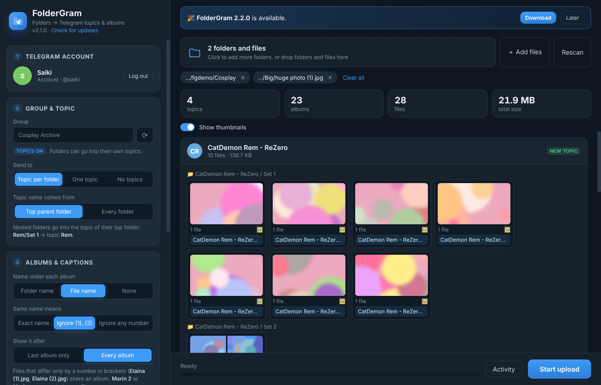

# FolderGram

Upload whole folders of photos and videos to a Telegram group, sorted into topics and albums.



## What it does

- **Topic per folder.** Each folder goes into a forum topic with its name. With nested folders, the
  **top parent folder** is the topic (`Rem/Set 1` and `Rem/Set 2` both go to topic `Rem`), or switch to
  "Every folder" to give each subfolder its own topic. Existing topics are reused (same name, any case);
  missing ones are created.
- **One topic** (pick or create a topic) or **No topics** (normal groups), with an optional
  `📁 folder` message before each folder.
- **Albums of up to 10** photos and videos. The name under each album can be:
  - the **folder name**, or
  - the **file name**: files with the same name share an album, with that name under it. You choose what
    "same name" means: **Exact name** (`Marin.jpg` + `Marin.mp4`), **Ignore (1), (2)** (the default:
    `Elaina (1).jpg` + `Elaina (2).jpg`, while `Marin 2` and `Marin-copy` stay separate), or **Ignore any number**
    (`Rem 01`, `Rem_02`, `Rem - Copy` together). Camera names like `IMG_2034` use the folder name.
  - shown after the **last album only** or after **every album**.
- **Add folders or single files** (button or drag and drop). Loose files go into a topic named after their folder.
- **Big photos stay in the album**: Telegram only accepts photos up to 10 MB, so larger ones are resized to
  2560 px (the largest size Telegram keeps for photos anyway) instead of arriving as files.
- **Preview before sending**: every topic, which ones are new, every album and its caption. Thumbnails are
  optional and switch off automatically above 500 files to keep the app fast.
- **Update check**: FolderGram tells you when a new version is on GitHub.
- **Resume**: files already sent are remembered and skipped next time. **Skip duplicates** also skips
  files with the same content under a different name.
- **Pause / resume / cancel**, upload speed and time left, progress on the Windows taskbar, and a
  notification when it finishes.
- **Send silently**, **pause between albums** (avoids Telegram rate limits), **file type filter**
  (photos / videos / audio / other), **order** by file name or date modified, **send as files**
  (original quality), **drag and drop** a folder onto the window.
- Videos are sent with their length, size and a thumbnail, so they play inline.
- Up to 2 GB per file (4 GB with Premium). Log in with your own account or a bot.

## Install

Download the latest `FolderGram-x.y.z-portable.exe` (or the Setup installer) from [Releases](https://github.com/Saiki1997/FolderGram/releases). No install needed. Windows SmartScreen may warn because the app
isn't code-signed: click **More info → Run anyway**.

To build it yourself, install Node.js 20+ from nodejs.org and double-click `build-windows.bat`.
The installer and the portable exe end up in `dist\`. Or push to GitHub and run the
"Build Windows app" workflow. To run from source, use `run-dev.bat`.

## First use

1. Get an **API ID** and **API hash** at <https://my.telegram.org/apps> (log in, create an app).
2. In FolderGram, enter them plus your phone number (with country code) and press **Log in**.
   Type the code Telegram sends you, and your 2-step password if you have one.
3. Pick the group. Groups with topics show a **TOPICS** tag. To use topics, turn on Topics in the
   group's settings; you must be an admin who can manage topics.
4. Choose or drop the folder, check the preview, press **Start upload**.

Using a bot instead: create one with @BotFather, make it an admin with **Manage topics**, choose "Bot"
and paste its token. Bots can't list chats, so type the group's @username or id (like `-1001234567890`).

Your login session, settings and upload history are stored in `%APPDATA%\FolderGram`, encrypted with
Windows' own data protection. **Log out** deletes the session.

## Development

```
npm install
npm test     # scanner, captions, topics, resume, duplicates, pause/cancel
npm start
```

- `src/core/scanner.js`: scans folders, groups files into albums, picks topic names and captions.
- `src/core/uploader.js`: runs the upload plan (topics, retries, flood waits, history, pause).
- `src/core/telegram.js`: Telegram via GramJS (MTProto).
- `src/main.js`, `src/preload.js`, `src/renderer/`: the Electron app.
